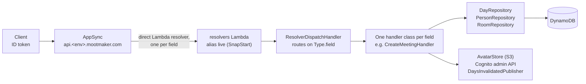

# How the API is built

The inside of mootmaker-api: the request path, how the code is organised, each Lambda, and the parts
with traps in them. Where it sits in the whole system is in the hub's
[system overview](https://github.com/geoffweatherall/mootmaker/blob/main/docs/overview/system.md).

## The request path

1. **AppSync** checks the Cognito token (`AMAZON_COGNITO_USER_POOLS`; IAM as a second mode, for the
   broadcast only) and validates the request against `api/mootmaker.graphql`.
2. Every query and mutation field has a **direct Lambda resolver** pointing at the `live` alias of one
   function, `resolvers`. A shared request template passes the identity, arguments, `info.fieldName`,
   `info.parentTypeName` and `info.selectionSetList` (which AppSync does not include unless asked).
   There is no VTL logic; the response is returned as the Lambda gives it.
3. **`ResolverDispatchHandler`** looks up `Type.field` in a map of handler instances, all built in its
   constructor so their initialisation is captured in the SnapStart snapshot. The constructor first runs
   `Limits.assertConsistent()`, so an inconsistent set of limits fails the deploy rather than a booking.
4. The **handler** checks the caller (`Identity`), validates, reads and writes through the repositories,
   and returns a map shaped like the schema's result type.

`publishDaysInvalidated` is the exception: it has a `NONE` data source that echoes the dates back, so
AppSync broadcasts them to `daysInvalidated` subscribers. Only IAM callers may use it.

## Code layout

| Package (`impl/src/main/java/com/mootmaker/`) | Holds |
|---|---|
| `handler` | One class per GraphQL field, the two Cognito triggers, `DatabaseResetHandler`, `DatabaseRepairHandler`, `HistoryCleanupHandler`, and shared pieces: `Identity` (who is calling, and are they allowed), `MeetingValidator`, `SelectionSet`, `UpcomingMeetings`, `FixtureUsers` |
| `model` | Records for stored and returned shapes (`Room`, `Person`, `MeetingRecord`, `Day`, `Meeting`), and the error enums, whose constant names must match the schema's |
| `dynamo` | Repositories. `DayRepository` owns the day-item read-modify-write loop, pointers, moves and retention |
| `limits` | `Limits`, every size limit and the proof they fit the platform caps; `Subjects`, byte-length rules |
| `avatar` | Decoding and re-encoding images, S3 storage, URL building |
| `realtime` | Publishing `publishDaysInvalidated` after a write |
| `cognito`, `s3`, `dynamo/DynamoDbClientProvider` | Shared, lazily built SDK clients |
| `concurrent` | `ConcurrencyUtils`: bounded parallelism (8) for independent reads |

## Patterns every handler follows

- **Check the caller first.** `Identity.requireAuthenticated`, `requireAdmin` (admin role or the M2M
  `admin` scope) or `requireAdminOrSelf`, before any other logic. A refusal is thrown and reaches the
  client as a GraphQL error; a validation failure is returned as data.
- **Collect every validation error** into the result's `errors` list rather than stopping at the first.
  Nothing is written unless the list is empty.
- **Fetch only what was selected.** `SelectionSet` reads `selectionSetList`; a resolver skips lookups for
  fields nobody asked for. Aliased fields count as selected, so the check fails towards fetching.
- **Writes to a day go through `DayRepository.mutate`**, which reads consistently, applies the change,
  re-validates, and writes conditionally on the version, retrying up to five times.
- **Writes that change meetings broadcast the changed dates** after they commit
  (`DaysInvalidatedPublisher`). A failed broadcast is logged and swallowed: the write has already
  succeeded, and failing it would turn a missed refresh into a lost booking.
- **Self-only operations take no id.** `updateMyName`, `updateMyPreferences`, `respondToMeeting` and
  `deleteMyAccount` act on the caller's own Person from the `custom:personId` claim.

## The Lambdas

All six are built from one jar, `impl/target/mootmaker-api.jar`, Java 25, 512 MB.

| Function | Invoked by | Timeout | Notes |
|---|---|---|---|
| `<env>-mootmaker-resolvers` | AppSync, via alias `live` | 15 s | SnapStart. Every GraphQL field |
| `<env>-mootmaker-post-confirmation-create-person` | Cognito, after sign-up is confirmed | 15 s | SnapStart. Creates the Person, sets `custom:personId` and `custom:class`. Logs and swallows its own failures so a sign-up never fails here |
| `<env>-mootmaker-pre-sign-up-name-collision` | Cognito, before an account is created | 15 s | SnapStart. Refuses a sign-up whose name matches an existing Person. Read only |
| `<env>-mootmaker-database-reset` | A person or a test, with AWS credentials | 900 s | Deletes data; see the hub's [data overview](https://github.com/geoffweatherall/mootmaker/blob/main/docs/overview/data.md#resetting-and-repairing-an-environment). Its Cognito wipe is turned off in `production` by a Terraform-set variable |
| `<env>-mootmaker-database-repair` | A person, with AWS credentials | 900 s | Creates missing Persons. `{"dryRun": true}` reports without writing |
| `<env>-mootmaker-history-cleanup` | EventBridge, Mondays 14:17 UTC (`test` and `production` only); tests | 300 s | Deletes days before the retention boundary and advances it |

The request-path functions share one IAM role (`lambda_exec`), scoped to this environment's tables,
avatars bucket, user pool and the single broadcast field. The other three each have their own role.

**Deploys publish a new version** of each SnapStart function and move `live` to it. SnapStart takes its
snapshot at publish time, which runs initialisation, so a fault in initialisation fails the deploy.
`deploy/prune-lambda-versions.sh` then deletes all but the live version and the newest three, so
versions do not pile up.

## Live updates: the traps

The broadcast chain is short, and every link in it can fail without an error anywhere the subscriber
can see. Each of these was found against a real AppSync API:

- **Both auth directives are needed on the `Invalidation` type** (`@aws_iam @aws_cognito_user_pools`).
  Without them subscribing succeeds and nothing is ever delivered. The only symptom is in the
  *publisher's* response body, which is why `DaysInvalidatedPublisher` reads a 200 response for
  `errors` rather than trusting the status.
- **A payload over 240 KB** is accepted and silently not delivered. Dates are tiny, which is one reason
  the broadcast carries dates and not data.
- **Unsupported subscription filters** fail silently, in either direction (deliver everything or
  nothing).
- **The realtime path differs by host**: `/graphql/realtime` on the custom domain, `/graphql` on the raw
  AppSync realtime host. The wrong one never connects.
- **AppSync refuses the `graphql-transport-ws` subprotocol** that standard clients speak. Clients use
  AppSync's own protocol; `verify/.../AppSyncSubscription.java` is a reference implementation.
- **The resolver's IAM grant names the one field**, `publishDaysInvalidated`, not the whole API: a
  broader grant would let the Lambda call any mutation as an IAM principal and skip the role checks.

## Avatars

`requestAvatarUpload` returns a presigned `PUT` URL that fixes the content type and exact length.
`confirmAvatarUpload` checks the image's dimensions from its header *before* decoding (so a small file
cannot claim enough pixels to exhaust memory), decodes it, centre-crops and re-encodes it as a 256 × 256
JPEG on white, writes it under a key containing the hash of the uploaded bytes, points the Person at it
and deletes the person's previous image. The uploaded bytes are never served. Writing an object that
already exists is normal (a retry, or the same image again) and must stay an unconditional overwrite.
Objects carry `Cache-Control: public, max-age=31536000, immutable`; a different image is a different
URL, so nothing ever needs invalidating. Storage layout: [data model](data-model.md#s3-env-mootmaker-avatars-account).

## Hostnames and certificates

Each environment has `api.<env>.mootmaker.com` (AppSync custom domain) and `avatars.<env>.mootmaker.com`
(CloudFront), with `<env>.` dropped in `production`. Each issues its own ACM certificate, DNS-validated
in the `mootmaker.com` zone, because a wildcard cannot cover two levels (`api.<env>.`). `deploy.sh`
refuses an environment name starting with `prod` that is not exactly `production`.

## Logging

Lambda logs go to `/aws/lambda/<function>`, AppSync errors (field log level `ERROR`, verbose content
excluded) to `/aws/appsync/apis/<api-id>`, all kept 120 days. The log groups are created by Terraform
before the functions, so Lambda never creates one with unlimited retention. If an environment ever has
a group Terraform did not create, `deploy/import-log-groups.sh <env>` imports it.
